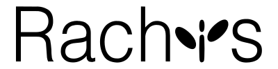
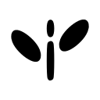
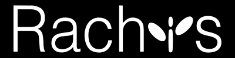
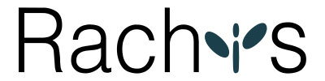

# Rachis logos

SVG, PNG, TIFF, and icon files for the Rachis wordmark, stamp, and favicon.

[Download the complete logo bundle](bundles/rachis-logos.zip).

> [!NOTE]
> The Rachis logo was designed by [Felicia Sandberg](https://github.com/fethalen).

<!-- BEGIN GENERATED LOGO GALLERY -->

## Logo gallery

Each preview links to its SVG.

| Color scheme | Wordmark | Stamp | Favicon |
| --- | --- | --- | --- |
| `bw_lightmode` | <a href="vector/wordmark/rachis-logo-bw_lightmode.svg"></a> | <a href="vector/stamp/rachis-stamp-bw_lightmode.svg"></a> | <a href="vector/favicon/rachis-favicon-bw_lightmode.svg"></a> |
| `bw_darkmode` | <a href="vector/wordmark/rachis-logo-bw_darkmode.svg"></a> | <a href="vector/stamp/rachis-stamp-bw_darkmode.svg"></a> | <a href="vector/favicon/rachis-favicon-bw_darkmode.svg"></a> |
| `darkmode` | <a href="vector/wordmark/rachis-logo-darkmode.svg"></a> | <a href="vector/stamp/rachis-stamp-darkmode.svg"></a> | <a href="vector/favicon/rachis-favicon-darkmode.svg"></a> |
| `lightmode` | <a href="vector/wordmark/rachis-logo-lightmode.svg"></a> | <a href="vector/stamp/rachis-stamp-lightmode.svg"></a> | <a href="vector/favicon/rachis-favicon-lightmode.svg"></a> |

Adaptive SVGs: [wordmark](vector/wordmark/rachis-logo-adaptive.svg) · [stamp](vector/stamp/rachis-stamp-adaptive.svg) · [favicon](vector/favicon/rachis-favicon-adaptive.svg).

Web icons: [adaptive favicon](raster/icons/favicon.svg) · [ICO fallback](raster/icons/favicon.ico) · [Apple touch icon](raster/icons/apple-touch-icon.png) · [web manifest](raster/icons/site.webmanifest).

<!-- END GENERATED LOGO GALLERY -->

## Color schemes

| Color scheme | Artwork | Intended background |
| --- | --- | --- |
| `bw_lightmode` | Black | Light |
| `bw_darkmode` | White | Dark |
| `darkmode` | Off-white lettering and blue wordmark symbol; white stamp and favicon | Dark |
| `lightmode` | Black lettering and teal symbol | Light |

Adaptive SVGs switch between `lightmode` and `darkmode` using `prefers-color-scheme`. PNG, TIFF, and ICO files use fixed colors.

## Files

Artwork types are `wordmark`, `stamp`, and `favicon`.

| Path | Contents |
| --- | --- |
| `vector/<type>/` | Fixed and adaptive SVGs |
| `raster/<type>/<scheme>/transparent/` | Transparent PNGs and TIFFs |
| `raster/<type>/<scheme>/white/` or `black/` | PNGs and TIFFs with solid backgrounds |
| `raster/icons/` | Favicons, touch and app icons, macOS iconset, and web manifest |
| `sources/vector/`, `sources/raster/` | Source artwork |
| `manifest.json` | File sizes and SHA-256 checksums |

The number in a raster filename is its width in pixels; height scales proportionally.

## Website usage

Copy the logo and icon files into your site's public directory and adjust these paths:

```html

<link rel="icon" href="/icons/favicon.ico" sizes="any">
<link rel="icon" href="/icons/favicon.svg" type="image/svg+xml">
<link rel="apple-touch-icon" href="/icons/apple-touch-icon.png">
<link rel="manifest" href="/icons/site.webmanifest">
```

For a manual theme switch, choose a fixed SVG matching the selected scheme. Inline adaptive SVGs also accept `data-theme="light"` or `data-theme="dark"` on their root element.

The default ICO uses `lightmode`; each scheme has its own ICO and PNGs under `raster/icons/<scheme>/`. Touch and app icons use a teal symbol on white. Keep the web manifest alongside its icon PNGs so its relative paths resolve.

## Regenerate the files

With Node.js 22 or newer, run:

```sh
npm ci
npm run build
npm run check
```

Edit artwork in `sources/vector/` and export sizes and colors in `logos.json` before rebuilding. `./rasterize.sh` also runs the build; `npm test` runs the rendering tests.

See [source details](sources/README.md) for artwork origins and palette references.
